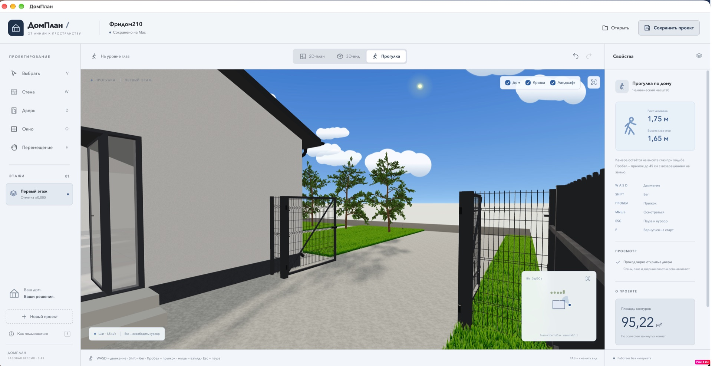
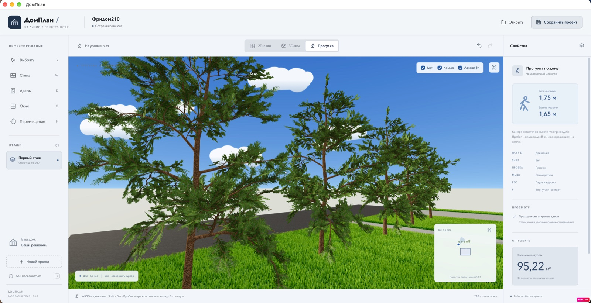
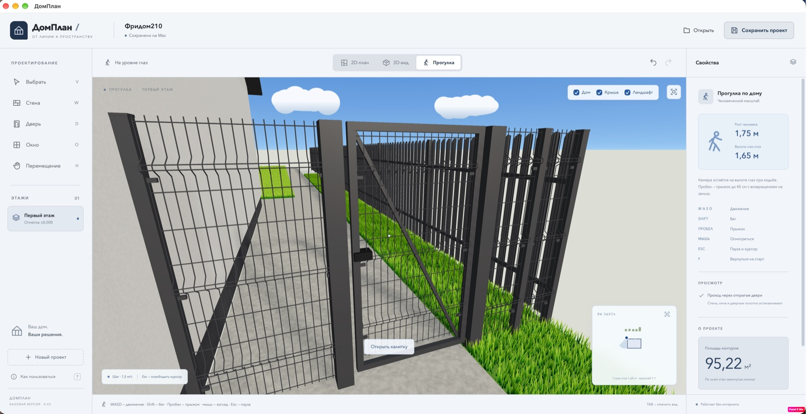

# ДомПлан — House Planner

Локальное приложение для планировки одноэтажного дома и участка. Нарисуйте стены, окна и двери на 2D-плане, подберите отделку и ландшафт в 3D, затем пройдите по дому от первого лица.

**Текущая версия — 0.43, сборка 44.** Нативное приложение рассчитано на **macOS 13 и новее, Apple Silicon**. Интерфейс на русском языке. После установки приложение работает без подключения к интернету.



[Скачать приложение для macOS](https://github.com/LittleBuster/house-planner/releases/latest) · [Исходный код](https://github.com/LittleBuster/house-planner)

## Содержание

- [Установка и первый запуск](#установка-и-первый-запуск)
- [Быстрый старт](#быстрый-старт)
- [2D-план и точные размеры](#2d-план-и-точные-размеры)
- [Окна, двери и входные ступеньки](#окна-двери-и-входные-ступеньки)
- [3D-вид и отделка дома](#3d-вид-и-отделка-дома)
- [Ландшафт и покрытия участка](#ландшафт-и-покрытия-участка)
- [Заборы, ворота и калитки](#заборы-ворота-и-калитки)
- [Прогулка от первого лица](#прогулка-от-первого-лица)
- [Сохранение и формат проекта](#сохранение-и-формат-проекта)
- [Горячие клавиши](#горячие-клавиши)
- [Разработка и сборка](#разработка-и-сборка)
- [Структура исходников](#структура-исходников)
- [Ограничения текущей версии](#ограничения-текущей-версии)
- [Зависимости и права на модели](#зависимости-и-права-на-модели)

## Установка и первый запуск

1. Скачайте `domplan-0.43.0-macos-arm64.zip` из последнего релиза.
2. Распакуйте архив и откройте `ДомПлан.app`. Приложение можно перенести в папку «Программы».
3. При первом запуске появится пример дома. Кнопка **Новый проект** создаёт пустой чертёж.

Для готового приложения Node.js и pnpm не требуются. Внутри находятся интерфейс, 3D-библиотека, материалы и модели растений.

Приложение имеет локальную ad-hoc подпись. Если macOS запрашивает подтверждение для загруженной сборки, используйте системный пункт **Открыть** в контекстном меню приложения или разрешите запуск в настройках **Конфиденциальность и безопасность**. Сборка не имеет нотариального заверения Apple.

## Быстрый старт

1. В режиме **2D-план** выберите инструмент **Стена** или нажмите `W`. Последовательными щелчками обведите внешний контур дома.
2. Для точного размера задайте начало стены, наведите курсор в нужную сторону и нажмите `Enter`. Размер готовой стены можно изменить в свойствах справа.
3. Добавьте перегородки. При наведении на существующую стену появляются отступы с двух сторон будущего примыкания.
4. Инструментами **Дверь** и **Окно** поставьте проёмы в стены. Выделите проём для изменения размеров, секций и открывания.
5. Переключитесь на **3D-вид**. Настройте фасад, цоколь, внутреннюю отделку, пол и крышу.
6. В **Ландшафтном дизайне** разместите деревья, покрытия, заборы, ворота и калитку.
7. Выберите **Прогулка → Начать прогулку**. Управляйте движением через WASD, осмотром через мышь.
8. Нажмите `⌘S`, чтобы сохранить переносимую копию проекта в JSON-файл.

## 2D-план и точные размеры

### Стены и примыкания

**Стена (`W`)** рисуется от первого щелчка ко второму. Следующие щелчки продолжают цепочку. `Esc` или правая кнопка мыши завершают цепочку, `Shift` фиксирует горизонтальное или вертикальное направление.

В режиме **Выбрать (`V`)** доступны три способа редактирования стены.

| Действие | Результат |
| --- | --- |
| Потянуть за середину стены | Перемещение стены целиком |
| Потянуть круглый маркер на конце | Изменение конца стены с учётом примыканий |
| Ввести длину, высоту или толщину справа | Точное изменение выбранного параметра |

Начало новой стены можно поставить внутри существующей. Редактор определяет сторону выхода и подрезает торец по грани стены. Общие углы и Т-образные примыкания учитываются при перемещении. При приближении к свободному торцу соседней стены включённая привязка помогает совместить угол.

При рисовании перегородки размерные выноски показывают свободное расстояние слева и справа от неё. Внутри комнаты отсчёт идёт до внутренней грани ограничивающей стены. Стыки имеют непрерывную заливку и штриховку.

### Привязка, длины и площадь

- При включённой **Привязке** шаг перемещения и изменения размеров стен и проёмов составляет **1 см**.
- Поля размеров и координат принимают значения с точностью до **0,001 м**. Поддерживаются запятая и точка как десятичный разделитель.
- Переключатель **Наружные размеры** задаёт измерение по внешним граням углов. При его отключении используются фактические грани примыкающих стен.
- Сетка участка в 2D и 3D имеет общее начало координат. Её видимый шаг настраивается от **0,5 до 5 м**, по умолчанию **2 м**.
- Замкнутый контур образует комнату и пол. Площадь комнаты рассчитывается **по осям стен**, без вычета их толщины.

Связанные стены ограничивают изменение длины. Один законченный жест записывается одним действием в историю отмены. Если после редактирования стены проём больше не помещается, приложение удаляет его с уведомлением. `⌘Z` восстанавливает предыдущее состояние.

### Навигация по чертежу

Обычная прокрутка перемещает план. Масштаб изменяется кнопками `−` и `+`, жестом щипка или `Control` с прокруткой. Инструмент **Перемещение (`H`)** позволяет перетаскивать чертёж. `F` вписывает план в рабочую область.

## Окна, двери и входные ступеньки

### Размещение и изменение проёмов

Выберите **Окно (`O`)** или **Дверь (`D`)** и нажмите на стену. Проём остаётся связан с этой стеной, включая вертикальные и наклонные стены.

Чтобы передвинуть проём, потяните стекло окна или середину двери. Чтобы изменить ширину в одну сторону, потяните соответствующий край. Противоположный край сохраняет положение. Проём останавливается у конца стены, соседнего окна, двери или грани пересекающей стены.

Пока проём выделен, видны его общая ширина и расстояния до ближайших препятствий с обеих сторон. Размеры обновляются во время перемещения и растягивания. Точные значения доступны в панели свойств.

### Секции и отделка окна

Окно может иметь **одну, две или три секции**. В свойствах задаются общая ширина, ширина каждой секции, высота и высота подоконника.

Изменение общей ширины пропорционально масштабирует секции. Изменение одной секции через поле ввода меняет общую ширину. Перетаскивание внутренней перемычки перераспределяет ширину между соседними секциями. Минимальная ширина секции составляет **10 см**.

Для рамы доступны **белый**, **RAL 7042**, **RAL 7024** и **под дерево**. Подоконник получает материал рамы. Стекло имеет серый оттенок.

В блоке **Форточки** отметьте открывающиеся секции. В 3D и прогулке щелчок по стеклу, ручке или открытому проёму открывает и закрывает створку внутрь дома. **Зеркалить петли** переносит петли выбранной секции на противоположную сторону. Настройка и состояние хранятся отдельно для каждой секции.

### Двери

Для двери настраиваются ширина, высота, расположение на стене и цвет полотна. Доступны белый, RAL 7047, RAL 7042, RAL 7024, под дерево, коричневый и чёрный. Общую отделку дверей можно задать для всего дома, индивидуальную — в свойствах выбранной двери.

В блоке **Открывание** можно изменить сторону распахивания и зеркально перенести петли. Щелчок по полотну или ручке в 3D и прогулке открывает или закрывает дверь.

Дверное полотно имеет столкновения на промежуточных углах. Оно останавливается перед человеком и препятствиями, затем продолжает движение, когда путь освобождается. Повторный щелчок меняет состояние открывания.

### Французское окно и ступеньки

Настройка **Французское окно** продлевает окно вниз до внутреннего пола. Пол и нижняя граница наружной двери находятся на верхней отметке цоколя. Для входа с земли можно прыгнуть на этот уровень либо поставить ступеньки.

В **3D → Ландшафтный дизайн → Ступеньки** выберите размещение и нажмите на наружную дверь или французское окно. Ступени подстраиваются под вход и высоту цоколя. Повторное нажатие убирает их. В прогулке на ступени можно заходить обычным шагом.

## 3D-вид и отделка дома

Стены, проёмы, пол и крыша строятся по общей модели проекта в метрах. Изменения чертежа отображаются в 3D и прогулке.

### Камера и отображение

| Управление | Действие |
| --- | --- |
| Левая кнопка мыши на свободном месте | Вращение камеры |
| Правая кнопка мыши | Перемещение камеры |
| Прокрутка | Приближение и отдаление |
| **Вид с участка** | Ракурс с меньшей высоты на фоне неба |
| **Сбросить ракурс** | Общий вид дома и участка |

Над сценой расположены независимые переключатели **Дом**, **Крыша**, **Ландшафт**. Они управляют видимостью соответствующих объектов. Скрытые группы также исключаются из столкновений прогулки. Для просмотра комнат можно отключить крышу.

Сцена включает дневное небо, солнце, тени и движущиеся облака.

### Фасад, внутренние стены и цоколь

| Элемент | Материалы и настройки |
| --- | --- |
| Фасад | Декоративная штукатурка или облицовочный кирпич |
| Штукатурка | Белый, RAL 7047, RAL 7042, RAL 7024 |
| Кирпич | Красный, терракотовый, песочный, коричневый, графитовый |
| Внутренние стены | Под покраску или декоративная штукатурка, белый и серые RAL |
| Цоколь | Цвет, высота от 5 до 80 см, уступ от 0 до 15 см |

Цоколь утоплен относительно фасада. По умолчанию его высота составляет **35 см**, уступ — **4 см**. Допустимый уступ ограничивается толщиной стены. Верх цоколя задаёт уровень внутреннего пола.

Фактуры отделки сохраняют физический масштаб при изменении размеров дома. Цвета RAL показаны экранными приближениями и зависят от освещения сцены.

### Внутренний пол

Покрытие выбирается для всего дома либо отдельной комнаты. Комнату можно выбрать на 2D-плане или в списке настроек пола в 3D.

| Материал | Фактуры |
| --- | --- |
| Паркет | Тонкое волокно, древесина с сучками, брашированная древесина |
| Керамогранит 60 × 60 см | Однотонный матовый, матовый бетон, матовый камень |
| Керамогранит 60 × 120 см | Однотонный матовый, матовый бетон, матовый камень |
| Линолеум | Однотонный, крапинка, под текстиль |

Доступны цвета древесины и однотонные оттенки, включая светло-серый матовый керамогранит. Направление укладки задаётся углом **0°, 45°, 90° или 135°**.

### Крыша

Поддерживаются **плоская**, **двускатная** и **многоскатная** крыши. Для скатных крыш подъём конька задаётся от **0,3 до 8 м**, свес — от **0 до 1,5 м**. У двускатной крыши выбирается направление конька.

Фактура может быть гладкой, под металлочерепицу или профлист. Цвета включают серо-синий, RAL 7042, RAL 7024, коричневый, терракотовый и чёрный.

Крыша следует внешнему замкнутому контуру. Она учитывает пристройки и перестраивается после изменения стен. На отдельные замкнутые постройки создаются отдельные крыши. Перегородки используются для комнат внутри общего контура.

Вместе с крышей появляются водосточные желоба и трубы. Скатные крыши получают трубчатые снегозадержатели. Эти детали окрашены в цвет кровли и скрываются вместе с ней.

## Ландшафт и покрытия участка

### Деревья и растения

В 3D слева доступны разделы **Деревья**, **Растения**, **Покрытия**, **Ступеньки** и **Заборы**.

| Растение | Количество форм | Допустимая высота |
| --- | --- | --- |
| Берёза | 5 | 0,5–20 м |
| Сосна | 15 | 0,5–20 м |
| Пихта | 9 | 0,5–20 м |
| Клён | 12 | 0,5–20 м |
| Трава и цветы | 9 | 0,05–2 м |
| Пучок травы | 1 | 0,05–2 м |

Выберите растение, затем форму и высоту справа. Щелчок по земле ставит экземпляр на участок. С `Shift` можно размещать несколько экземпляров подряд. Карточку растения также можно перетащить в сцену.

У выделенного растения меняются высота, поворот и координаты. Его можно перетащить мышью или удалить. При масштабировании сохраняются пропорции. Стволы проверяются на пересечения со стенами и соседними стволами.

Вокруг выделенного дерева появляется кольцо поверх травы. Размерные стрелки идут к ближайшим препятствиям по осям участка. Расстояния между деревьями измеряются между стволами.

В прогулке ветки, листва и хвоя проходимы. Столкновение с деревом ограничено узкой зоной ствола, радиус которой зависит от формы и высоты модели. Трава и цветы проходимы.



### Покрытия земли

| Покрытие | Вид поверхности |
| --- | --- |
| Газон | Объёмная трава высотой около 12 см |
| Чернозём | Тёмная зернистая земля |
| Песок | Светлая мелкая фактура |
| Бетон | Матовая поверхность для дорожек и отмостки |
| Щебень 0–20 мм | Колотый камень и мелкий отсев |
| Асфальт | Тёмная мелкозернистая поверхность |

Выберите материал и задайте ширину и длину от **0,1 до 20 м**. По умолчанию создаётся участок **2 × 2 м**. Щелчок по земле задаёт его центр.

Покрытия имеют произвольные размеры и положение. При перемещении края притягиваются к соседним покрытиям на расстоянии до **10 см**. `⌥ Option` временно отключает притягивание.

У выделенного покрытия доступны четыре боковых маркера и маркеры углов. Боковой маркер изменяет один размер, угловой — оба сразу. Противоположная сторона сохраняет положение. Размеры, координаты центра и уложенная площадь отображаются справа.

Газон повторяется блоками **2 × 2 м**, а фактуры остальных материалов сохраняют масштаб при растягивании площадки. Край покрытия автоматически подрезается по цоколю дома. Все материалы видны в прогулке и сохраняются в проекте.

### Копирование покрытий

Выделите площадку и нажмите `Ctrl+C` или `⌘C`. Затем `Ctrl+V` или `⌘V` включает укладку копий с тем же материалом и размерами. Щёлкайте по земле для размещения. `Esc` завершает режим.

## Заборы, ворота и калитки

### Секции забора

В **Ландшафтный дизайн → Заборы** доступны сварная 3D-сетка и металлоштакетник. Новая секция имеет длину **2,5 м между осями столбов** и высоту **1,8 м**.

Первый щелчок ставит начальный столб, второй задаёт направление секции. Следующие секции продолжают прямую линию через общий столб. `Shift` позволяет повернуть, `Esc` завершает размещение.

Секцию можно перетаскивать мышью. При стыковке конец притягивается к соседнему столбу или полотну. Пересечённые секции делятся на отдельные части, в месте стыка используется общий столб. Лишнюю часть можно выделить и удалить.

Для забора доступны зелёный, RAL 7024, коричневый и оцинкованный варианты. В свойствах выбирается сторона обрешётки или рёбер сетки. У выделенной секции отображаются расстояния до соседних препятствий.

### Ворота и калитка

| Параметр | Ворота | Калитка |
| --- | --- | --- |
| Створки | Две распашные | Одна распашная |
| Ширина прохода | 2–6 м | 0,8–1,5 м |
| Высота | 1,8 м | 1,8 м |
| Заполнение | Сетка или металлоштакетник | По выбранному забору |
| Опоры | Два крайних столба | Два крайних столба |

Ворота и калитка встраиваются в непрерывный прямой участок существующего забора. Для ворот выберите подходящий тип заполнения, задайте ширину и нажмите на секцию. Калитка принимает заполнение и цвет забора автоматически.

Проём подрезает полотно и убирает промежуточные столбы внутри него. После удаления ворот или калитки восстанавливается заполнение забора. Ширина проезда или прохода указывается между внутренними гранями опорных столбов.

У выделенного проёма появляются стрелки перемещения. Потяните стрелку вдоль забора или щёлкните по ней для сдвига на **1 см**. С обеих сторон видны расстояния от осей столбов проёма до концов прямого участка. Перемещение ограничивается концами участка, примыканиями и другими проёмами.

Настройки **Внутрь / Наружу** выбирают сторону распахивания относительно дома. **Зеркалить открывание** переносит петли калитки на другой столб, а у двухстворчатых ворот меняет створку с защёлкой.

В 3D открывание включается кнопкой в свойствах. В прогулке достаточно нажать на ворота или калитку. Створки имеют металлические рамы, петли и столкновения на каждом угле поворота. Они останавливаются перед человеком и продолжают движение, когда путь освобождается. Через открывшийся проём можно пройти.



## Прогулка от первого лица

Выберите **Прогулка → Начать прогулку**. При необходимости освободите курсор через `Esc`. В Mac-приложении относительное движение мыши обрабатывает AppKit, в браузере используется Pointer Lock или обзор перетаскиванием.

| Параметр | Значение |
| --- | --- |
| Рост человека | 1,75 м |
| Высота глаз | 1,65 м над текущей опорой |
| Радиус тела | 0,22 м |
| Скорость шага | 1,5 м/с |
| Скорость бега | 3,2 м/с |
| Высота прыжка | До 0,45 м |

Движение выполняется через `WASD` или стрелки, бег — с `Shift`, прыжок — на `Пробел`. Прыжок подчиняется гравитации. Следующий прыжок доступен после приземления и нового нажатия.

Стены, оконное стекло, дверные полотна, заборы, столбы и створки ворот останавливают человека. Дверные перемычки и крыша ограничивают свободное пространство по высоте. Через ветки и листву деревьев можно проходить и прыгать, у дерева препятствием служит ствол.

Старт выбирается внутри доступной комнаты. Для незамкнутого плана выбирается свободное место рядом с геометрией. Мини-карта показывает положение и направление взгляда. `F` возвращает на старт.

Кнопка **Прогулка на весь экран** разворачивает сцену с перекрытием панелей macOS. Повторное нажатие возвращает редактор. `Esc` освобождает курсор и ставит прогулку на паузу.

## Сохранение и формат проекта

**Сохранить проект** или `⌘S` открывает системный диалог и сохраняет файл `*.domplan.json`. **Открыть** или `⌘O` загружает сохранённый проект. JSON-файл можно перенести на другой компьютер с ДомПланом.

Текущее состояние автоматически сохраняется локально.

| Среда | Хранилище |
| --- | --- |
| Приложение macOS | `~/Library/Application Support/DomPlan/project.json` |
| Браузер | `localStorage`, ключ `domplan-project-v1` |

Автосохранение хранит последнее состояние. Экспорт через **Сохранить проект** создаёт отдельную копию. История отмены относится к текущему сеансу работы.

Формат данных имеет `version: 1`. Координаты, длины и высоты выражены в метрах. Основные поля проекта перечислены ниже.

| Поле | Содержимое |
| --- | --- |
| `name` | Название проекта |
| `walls` | Стены с концами, высотой и толщиной |
| `openings` | Окна и двери со связью по `wallId`, размеры и открывание |
| `plants` | Вид, форма, координаты, высота, поворот и seed растения |
| `lawn` | Прямоугольные покрытия, их материал и размеры |
| `fences` | Секции заборов, цвет и сторона обрешётки |
| `gates` | Ворота и калитки, ширина, открывание и зеркалирование |
| `roof`, `facade`, `interior`, `plinth` | Параметры крыши и отделки |
| `floor`, `roomFloors` | Общее и индивидуальные покрытия пола |
| `display`, `siteGrid` | Видимость групп и сетка участка |

Импорт проверяет типы, допустимые размеры, связи объектов и лимиты проекта. Отсутствующие необязательные параметры читаются с совместимыми значениями. Файлы проекта содержат параметры сцены, модели растений встроены в приложение.

## Горячие клавиши

| Клавиша | Действие |
| --- | --- |
| `V` | Выбор объектов в 2D |
| `W` | Рисование стены в 2D |
| `D` | Размещение двери в 2D |
| `O` | Размещение окна в 2D |
| `H` | Перемещение чертежа |
| `Enter` | Ввод точной длины при рисовании стены |
| `Shift` | Ограничение направления стены, поворот забора или повторная посадка |
| `Esc` | Завершить текущий инструмент, отменить жест или поставить прогулку на паузу |
| `Delete` / `Backspace` | Удалить выбранный объект |
| `⌘Z` / `Ctrl+Z` | Отмена |
| `⇧⌘Z` / `Ctrl+Shift+Z` | Повтор |
| `⌘S` / `Ctrl+S` | Экспорт проекта |
| `⌘O` / `Ctrl+O` | Открыть проект |
| `⌘C` / `Ctrl+C` | Скопировать выделенное покрытие |
| `⌘V` / `Ctrl+V` | Включить размещение копий покрытия |
| `Tab` | Переключение 2D → 3D → прогулка |
| `F` | Показать весь план или вернуть камеру/человека на старт |
| `WASD`, стрелки | Движение в прогулке |
| `Shift` в прогулке | Бег |
| `Пробел` в прогулке | Прыжок |
| `⌥ Option` при работе с покрытием | Временно отключить притягивание |
| `?` | Встроенная справка |

## Разработка и сборка

### Стек

| Часть | Технологии |
| --- | --- |
| Интерфейс и состояние редактора | TypeScript, React, React DOM |
| 2D-чертёж | SVG |
| 3D-сцена и модели | Three.js, GLB/glTF |
| Геометрия контуров и подрезка | Clipper |
| Сборка веб-части | esbuild |
| Проверка типов | TypeScript |
| Проверки геометрии и поведения | Node.js test runner, tsx |
| Приложение macOS | Swift, AppKit, WebKit/WKWebView |

### Требования для разработки

- Node.js **22 и новее**.
- pnpm **11 и новее**.
- Для нативной сборки — Mac с Apple Silicon, macOS 13+, Swift и Apple Command Line Tools.

Установить Command Line Tools можно командой `xcode-select --install`. Для браузерной разработки достаточно Node.js и pnpm. Версии зависимостей зафиксированы в `pnpm-lock.yaml`.

### Запуск из исходников

```sh
git clone https://github.com/LittleBuster/house-planner.git
cd house-planner
pnpm install --frozen-lockfile
pnpm dev
```

Редактор откроется по адресу `http://127.0.0.1:4173`. Команда разработки пересобирает интерфейс при изменениях исходников.

### Проверка и сборка приложения

```sh
pnpm test
pnpm build
pnpm mac
open 'build/ДомПлан.app'
```

`pnpm build` выполняет проверку TypeScript и собирает веб-часть в `dist/`. `pnpm mac` компилирует Swift-оболочку, добавляет веб-ресурсы и создаёт `build/ДомПлан.app` с локальной подписью.

Текущий скрипт нативной сборки использует цель `arm64-apple-macosx13.0`. Он читает уже собранную папку `dist`, поэтому после изменений веб-интерфейса сначала выполните `pnpm build`.

Готовую веб-версию также можно открыть из `dist/index.html` в браузере с WebGL 2. Серверная часть приложению не требуется.

### Проверка нативной сборки

```sh
'build/ДомПлан.app/Contents/MacOS/DomPlan' --smoke-test /tmp/domplan-smoke.json
cat /tmp/domplan-smoke.json
codesign --verify --deep --strict 'build/ДомПлан.app'
```

Режим `--smoke-test` проверяет запуск WebKit, 2D, 3D, прогулку и встроенный ландшафт. Он использует отдельное хранилище и записывает результат в JSON с полем `ok`.

### Модели и подготовка ресурсов

Готовые модели находятся в `assets/plants/` и используются непосредственно при сборке. Исходные пользовательские наборы находятся в `assets/source/`.

```sh
pnpm prepare-plants
pnpm prepare-lawn
```

Первая команда извлекает отдельные формы деревьев и растений, нормализует геометрию и обновляет `src/plantManifest.ts`. Вторая подготавливает квадратную модель газона. Для обычной сборки подготовленные ресурсы уже включены в репозиторий.

### Подготовка архива приложения

```sh
ditto -c -k --sequesterRsrc --keepParent \
  'build/ДомПлан.app' \
  'build/domplan-0.43.0-macos-arm64.zip'
```

Готовое приложение хранится в GitHub Releases. Папки `build/`, `dist/`, `node_modules/`, локальные экспорты `*.domplan.json` и журналы исключены из Git.

## Структура исходников

```text
house-planner/
├── assets/
│   ├── plants/                 Подготовленные GLB-модели
│   ├── source/                 Исходные наборы моделей
│   └── README.md               Авторы, лицензии и подготовка ресурсов
├── docs/images/                Скриншоты приложения
├── native/
│   ├── App.swift               Окно macOS, меню, файлы и захват мыши
│   └── AppIcon.icns            Значок приложения
├── scripts/                    Сборка и подготовка GLB
├── src/
│   ├── main.tsx                Интерфейс, история, сохранение и команды
│   ├── model.ts                Данные, импорт, комнаты и базовая геометрия
│   ├── PlanView.tsx            Чертёж и взаимодействие в 2D
│   ├── ThreeView.tsx           3D-сцена и жизненный цикл рендера
│   ├── WalkControls.ts         Движение и ввод в прогулке
│   ├── walkPhysics.ts          Столкновения, опора, прыжки и проходы
│   ├── OpeningController.ts    Анимация дверей, окон, ворот и калиток
│   ├── LandscapeScene.ts       Размещение и перемещение на участке
│   ├── LandscapePanel.tsx      Каталог ландшафта
│   ├── plantModels.ts          Загрузка и создание растений
│   ├── lawnModels.ts           Покрытия и повторение объёмной травы
│   ├── groundMaterials.ts      Фактуры покрытий земли
│   ├── FenceLayer.ts           Секции и столбы заборов
│   ├── GateLayer.ts            Модели ворот и калиток
│   ├── GateHandles.ts          Стрелки и размеры вдоль забора
│   ├── gatePlacement.ts        Встраивание, подрезка и перемещение проёмов
│   ├── roofModel.ts            Контуры и скаты крыши
│   ├── facadeGeometry.ts       Наружные поверхности стен
│   ├── floorMaterials.ts       Покрытия внутреннего пола
│   ├── sky.ts                  Небо, солнце и облака
│   └── *.test.ts               Проверки геометрии и поведения
├── index.html
├── package.json
├── pnpm-lock.yaml
├── tsconfig.json
└── THIRD-PARTY-NOTICES.txt      Уведомления о сторонних компонентах
```

## Ограничения текущей версии

ДомПлан предназначен для эскизной планировки и визуальной оценки пространств. При строительстве размеры и конструктивные решения требуют отдельной проверки.

| Область | Текущая реализация |
| --- | --- |
| Этажность | Один этаж |
| Геометрия | Прямые стены и прямоугольные проёмы |
| Стены | До 300 |
| Окна и двери | До 1000 |
| Растения | До 100 экземпляров |
| Покрытия земли | До 400 площадок |
| Заборы | До 400 секций |
| Ворота и калитки | До 100 проёмов суммарно |
| Размер JSON | Проверяется лимит около 5 МБ |
| Нативная сборка | macOS 13+, arm64 |

Площади помещений вычисляются по осям стен. Крыша формируется автоматически по контуру дома. Мебель, инженерные расчёты, DWG/DXF и выпуск строительных чертежей находятся за пределами возможностей версии 0.43.

## Зависимости и права на модели

React, React DOM, Scheduler и Three.js используют MIT. Clipper распространяется по Boost Software License 1.0 и включает уведомление JSBN. Полные тексты и сведения об авторах находятся в `THIRD-PARTY-NOTICES.txt`. Файл включён и в ресурсы приложения.

| Ресурс | Автор | Условия, записанные в исходных моделях |
| --- | --- | --- |
| Наборы берёз, сосен, пихт и клёнов | LOLIPOP | CC BY 4.0 |
| Scanned Plants and Grass | Kless | CC BY 4.0 |
| Grass | Asia Matusik | CC BY 4.0 |
| Patch of Grass | assetfactory | Sketchfab Standard |

Ссылки на авторов, исходные модели и описание адаптации приведены в `assets/README.md`. Условия Sketchfab Standard для газона рассматриваются отдельно от CC BY 4.0 остальных наборов. Сторонние модели сохраняют права своих авторов.

Лицензия собственного кода приложения отдельно не назначена. Лицензии зависимостей и моделей действуют на соответствующие компоненты.
